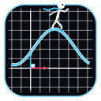
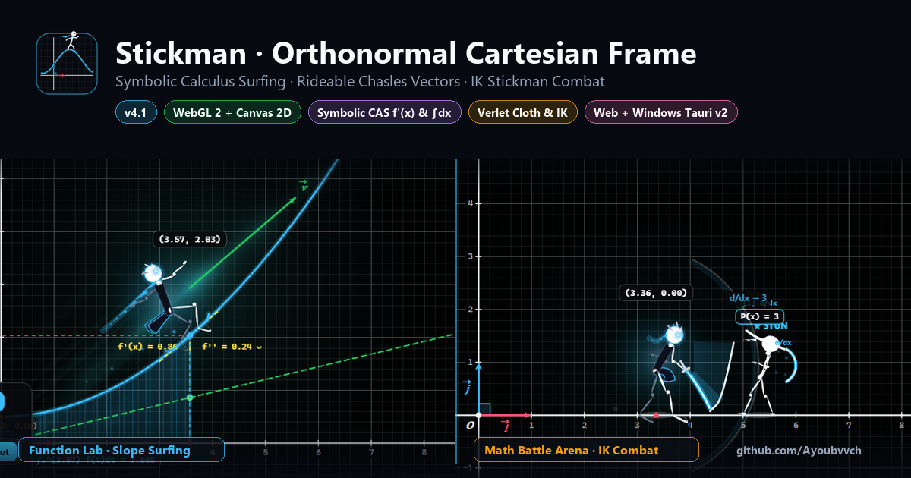

<div align="center">



# ستيكمان · المعلم المتعامد الممنظم (Stickman Cartesian Frame)

**لعبة تفاعلية للرياضيات والتفاضل والتكامل والفيزياء المتجهية والحركة الإجرائية (IK + Verlet) على معلم متعامد ممنظم**

*مبنية بالكامل بلغة JavaScript خالصة مع Canvas 2D و WebGL 2 ومحرك حساب رمزي CAS، ومتاحة للعب عبر المتصفح أو كتطبيق ويندوز عبر Tauri v2.*

[English](README.md) · [العربية](README.ar.md)

<p>
  <a href="https://ayoubvvch.github.io/stickman-cartesian-game/">
    
  </a>
  <a href="https://github.com/Ayoubvvch/stickman-cartesian-game/releases/latest">
    
  </a>
</p>



</div>

---

## نظرة عامة

**ستيكمان · المعلم المتعامد الممنظم** يحوّل المعلم الديكارتي المتعامد الممنظم $(O;\, \vec{i},\, \vec{j})$ إلى ساحة فيزيائية ورياضية تفاعلية متكاملة تجمع بين التعليم والأكشن:

- استكشف **الإحداثيات الديكارتية** والإسقاطات العمودية ومتجهات السرعة وتسلّق محور الأراتيب ($x = 0$).
- ارسم أي دالة $y = f(x)$ وتزلّج على منحناها في الأرباع الأربعة مع حساب رمزي فوري للمشتقة الأولى $f'(x)$ والمشتقة الثانية $f''(x)$ والتكامل $\int_0^x f(t)\,dt$ ونقط القمم والقيعان والجذور.
- أطلق متجهات $\vec{u} = (u_x, u_y)$، واقفز لركوبها وتوجيهها بحرية بزاوية $360^\circ$ مع تطبيق **علاقة شال** ($\vec{u} + \vec{w} = \vec{R}$) أثناء الطيران!
- خُض **ساحة المعركة الرياضية** بأسلوب *Alan Becker × Dead Cells* باستخدام أسلحة رياضية (`d/dx`، `∫ dx`، `-f(x)`، `-v⃗ / ⊥`) ومهارات الصدّ (`Parry`) والسحق الأرضي.
- اختبر فهمك في **6 تحديات لإتقان المشتقات** (جسر المماس، القمم والقيعان الحرجة، نقط الانعطاف، ركوب منحنى المشتقة، الوصلة الناعمة $C^1$، وحساب القفزة والميل).

---

## المميزات الرئيسية

### 1. المعلم المتعامد الممنظم $(O;\, \vec{i},\, \vec{j})$
- مقياس متعامد متساوي الوحدات ($\|\vec{i}\| = \|\vec{j}\| = 1$) مع تكبير وتصغير ديناميكي (`18–220 px/u`).
- عرض مباشر لإحداثيات $(x, y, v_x, v_y)$ والإسقاطات المتعامدة (`P`) ومتجهة السرعة (`V`) والوضعين الداكن والفاتح (`T`).

### 2. مختبر الدوال والحساب الرمزي (`f(x) Function Lab`)
- محلل صيغ رياضية ومحرك اشتقاق رمزي ([`js/math-cas.js`](js/math-cas.js)) يدعم كثيرات الحدود والدوال المثلثية والزائدية والأسية واللوغاريتمية (`sin`, `cos`, `tan`, `exp`, `ln`, `log`, `abs`, `sqrt`, `π`, `e`, إلخ).
- عرض تخطيطي للمشتقة $f'(x)$ وتظليل المساحة الجبرية للتكامل $\int_0^x f(t)\,dt$ وتحديد الجذور والقيم القصوى تلقائيًا.
- إمكانية النزول عبر المنحنى إلى الربعين الثالث والرابع (`S + Space`).

### 3. قاذف المتجهات وعلاقة شال ($\vec{u} + \vec{w} = \vec{R}$)
- أطلق المتجهة بـ `U` أو بالتصويب بالماوس، ثم اركض (`Shift`) أو اقفز لركوب المتجهة في الجو.
- تحكم سلس في اتجاه المتجهة بـ `W/A/S/D`، وتسريع مضاعف (`×2.35`) بـ `Shift`، وتطبيق **علاقة شال** بضغط `U` أثناء الركوب لجمع متجهتين آنيًا.

### 4. ساحة المعركة الرياضية (`Math Battle Arena`)
- **4 أسلحة رياضية**:
  - `[1] d/dx` (كاتانا الاشتقاق): لتخفيض درجة كثيرات الحدود حتى الصفر.
  - `[2] ∫ dx` (السيف الثقيل للتكامل): لسد فجوات المساحة السالبة وتنعيم الزوايا الحادة `|x|`، مع ضربة سحق أرضي (`S + هجوم`).
  - `[3] -f(x)` (نصلان النظير): لإلغاء الدوال الصامدة مثل $e^x$ و $\sin(x)$ و $\cos(x)$ عبر التداخل الهدّام.
  - `[4] -v⃗ / ⊥` (رمح القوة): لمعادلة القوى المتجهية المعاكسة أو المتعامدة.
- **صدّ الهجمات (`K` أو كليك يمين)**: صدّ هجمات الأعداء عند وميض `!` لاسترجاع `+4 HP` وتنفيذ ضربة حرجة (`PARRY CRIT`).
- **6 أنواع أعداء** بما فيهم **الزعيم المركّب ذو 4 مراحل** كل 5 موجات.

### 5. تحديات إتقان المشتقات (6 مراحل)
1. **جسر المماس**: إنشاء مستقيم مماس يطابق الارتفاع والميل.
2. **القمم والقيعان الحرجة**: تحديد مواضع $f'(x) = 0$ وتثبيتها بالزر `B`.
3. **نقط الانعطاف والتقعر**: تحديد مواضع $f''(x) = 0$ على منحنى الجرس.
4. **ركوب منحنى المشتقة**: اشتقاق $h(x)$ وبناء $y = h'(x)$ للتزلج نحو النجمة.
5. **وصلة ناعمة $C^1$**: وصل منحنيين بنفس الارتفاع والميل عند $x = 2$.
6. **حساب القفزة والميل**: ضبط الارتفاع والميل عند الحافة للانطلاق نحو النجمة.

### 6. فيزياء القماش والشعر (Verlet) وأنماط المحاربين
- محاكاة فيزيائية للوشاح والشعر وذيل المعطف وعباءة الزعيم عبر [`js/verlet-rig.js`](js/verlet-rig.js) مع مرونة `SpringScalar` وحساب حركي عكسي (`2-Bone & Closed-Chain IK`).
- **4 أنماط أنمي قابلة للتبديل (`N`)**: `Infinity` (غوجو) · `Zero Curse` (توجي) · `Crimson Pyre` (بينيمارو) · `Animator+` (آلان بيكر) متزامنة مع مؤثرات **WebGL 2**.

---

## اللعب والتشغيل السريع

- **عبر المتصفح مباشرة**: [https://ayoubvvch.github.io/stickman-cartesian-game/](https://ayoubvvch.github.io/stickman-cartesian-game/)
- **تحميل نسخة ويندوز (Tauri v2)**: من صفحة [الإصدارات (Releases)](https://github.com/Ayoubvvch/stickman-cartesian-game/releases/latest) (مثبت `.exe` / `.msi` أو نسخة محمولة `.zip`).
- **التشغيل المحلي**:
  ```bash
  git clone https://github.com/Ayoubvvch/stickman-cartesian-game.git
  cd stickman-cartesian-game
  npx serve .
  ```

---

## المساهمة والترخيص

نرحب بمساهماتكم واقتراحاتكم! راجع [CONTRIBUTING.md](CONTRIBUTING.md) للمشاركة في التطوير.
المشروع مرخص تحت [رخصة MIT](LICENSE).
