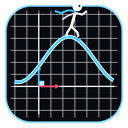
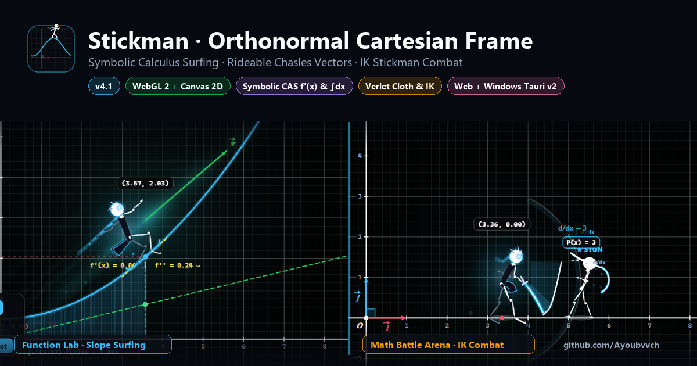
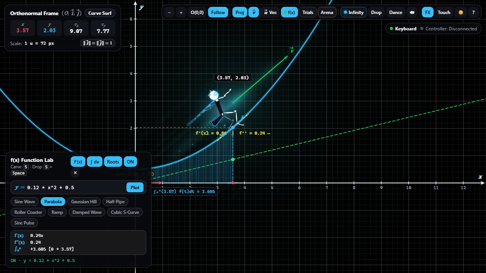
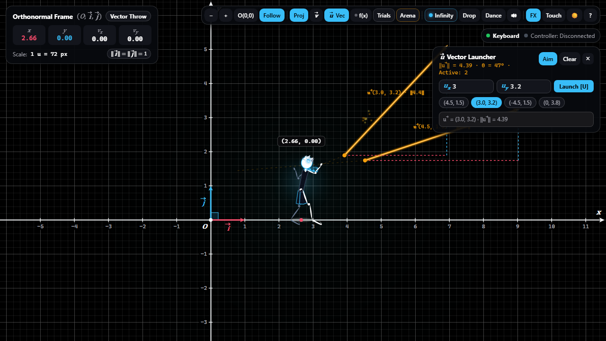
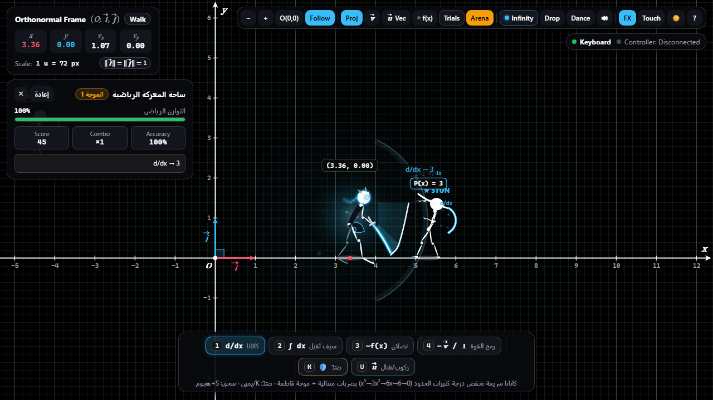
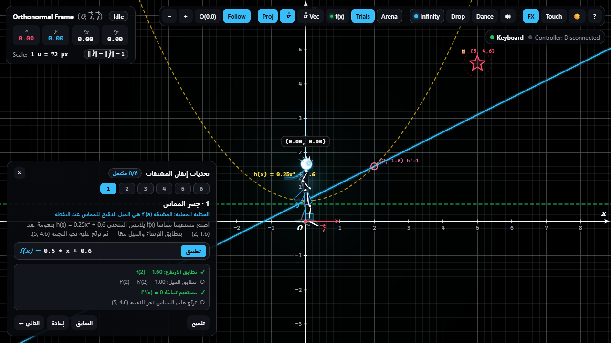
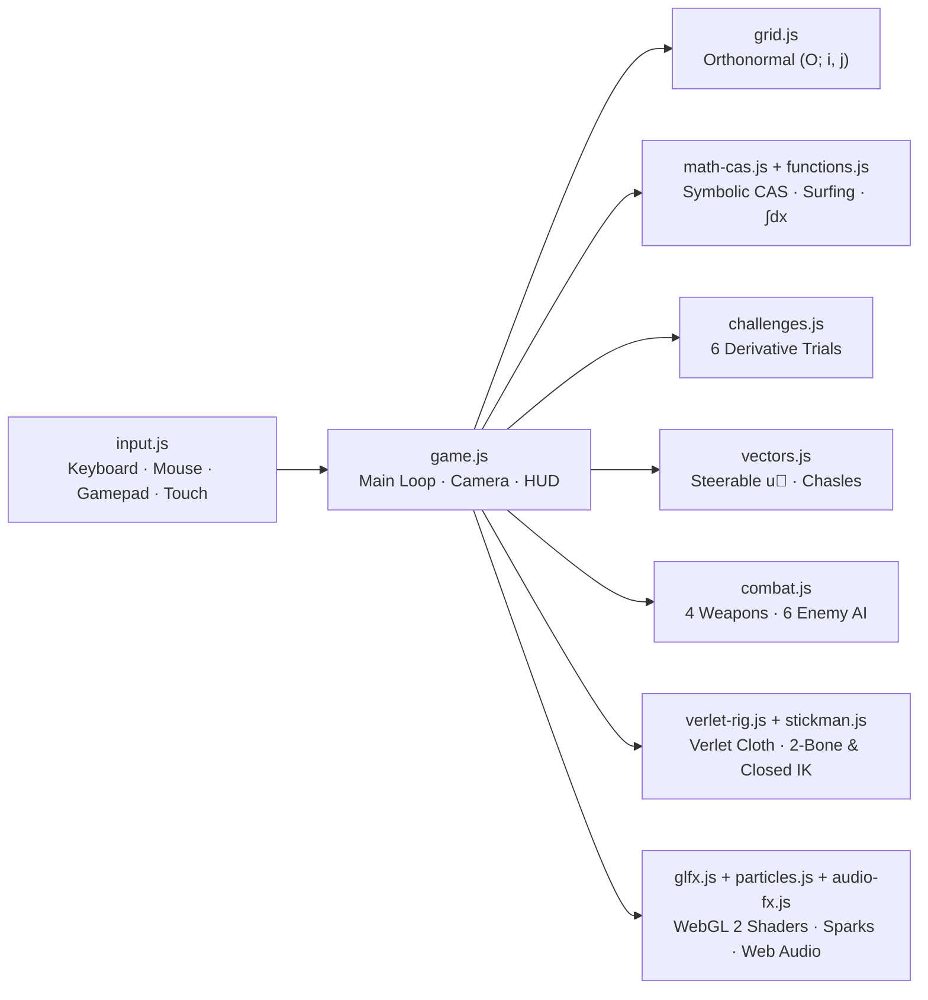

<div align="center">



# Stickman · Orthonormal Cartesian Frame

**Interactive 2D Calculus Platformer, Steerable Vector Engine & Procedural-IK Stickman Action Game**

*Zero-dependency Canvas 2D + WebGL 2 + Symbolic CAS + Verlet Physics — playable in browser & packaged for Windows with Tauri v2.*

[English](README.md) · [العربية](README.ar.md)

<p>
  <a href="https://ayoubvvch.github.io/stickman-cartesian-game/">
    
  </a>
  <a href="https://github.com/Ayoubvvch/stickman-cartesian-game/releases/latest">
    
  </a>
</p>

<p>
  
  
  
  
  
</p>



</div>

---

## Table of Contents

- [Overview](#overview)
- [Visual Showcase](#visual-showcase)
- [Core Features](#core-features)
  - [1. Orthonormal Cartesian Coordinate Plane](#1-orthonormal-cartesian-coordinate-plane-o-ij)
  - [2. Symbolic CAS & Function Surfing Lab](#2-symbolic-cas--function-surfing-lab-y--fx)
  - [3. Physical Vector Launcher & Chasles Composition](#3-physical-vector-launcher--chasles-composition)
  - [4. Math Battle Arena (Alan Becker × Dead Cells IK Combat)](#4-math-battle-arena-alan-becker--dead-cells-ik-combat)
  - [5. Derivative Mastery Trials (6 Interactive Challenges)](#5-derivative-mastery-trials-6-interactive-challenges)
  - [6. Procedural Verlet Cloth, Spine IK & Anime Warrior Styles](#6-procedural-verlet-cloth-spine-ik--anime-warrior-styles)
- [Controls Reference](#controls-reference)
- [Quick Start & Installation](#quick-start--installation)
- [Architecture](#architecture)
- [Contributing & License](#contributing--license)

---

## Overview

**Stickman · Orthonormal Cartesian Frame** turns a mathematically accurate 2D orthonormal coordinate plane $(O;\, \vec{i},\, \vec{j})$ into a high-speed physics playground, calculus laboratory, and procedural-animation action game.

Sprint across the $x$-axis, climb the $y$-axis, surf arbitrary mathematical curves $y = f(x)$ across all four quadrants while inspecting live symbolic derivatives and Riemann/Simpson integrals, **physically throw and ride steerable vectors** using **Chasles' relation** ($\vec{u} + \vec{w} = \vec{R}$), and fight articulated IK Stickman constructs using calculus operators as melee weapons.

> **Bilingual Educational Design:** The main HUD, Function Lab, and Controls Guide are in **English**, while the **Derivative Mastery Trials** (`تحديات إتقان المشتقات`) and **Math Battle Arena** (`ساحة المعركة الرياضية`) feature rich **Arabic** mathematical prompts alongside universal math notation (`d/dx`, `∫ dx`, `-f(x)`, `-v⃗ / ⊥`).

---

## Visual Showcase

<table>
  <tr>
    <td width="50%">
      
      <p align="center"><b>Function Lab &amp; Slope Surfing</b> — Live symbolic <code>f'(x)</code>, <code>f''(x)</code>, tangent slope readout, signed integral shading <code>∫₀ˣ</code>, and local extrema markers.</p>
    </td>
    <td width="50%">
      
      <p align="center"><b>Steerable Vector Launcher &amp; Chasles Addition</b> — Aim and throw vector spears <code>u⃗</code>, board them mid-sprint, steer 360°, and compose <code>u⃗ + w⃗ = R⃗</code>.</p>
    </td>
  </tr>
  <tr>
    <td width="50%">
      
      <p align="center"><b>Math Battle Arena</b> — 3-hit IK melee combos, crescent slash smears, sword-wave projectiles, timed parries, and calculus-driven enemy archetypes.</p>
    </td>
    <td width="50%">
      
      <p align="center"><b>6 Derivative Mastery Trials</b> — Interactive challenges covering tangent bridges, stationary points, inflection flips, derivative curves, and <code>C¹</code> continuity.</p>
    </td>
  </tr>
</table>

---

## Core Features

### 1. Orthonormal Cartesian Coordinate Plane `(O; i, j)`

- **True 1:1 Aspect Ratio**: Equal unit lengths along both axes ($\|\vec{i}\| = \|\vec{j}\| = 1$) with adaptive major/minor grid ticks (`18–220 px/unit`).
- **Live Telemetry & Projections**: Real-time $(x, y, v_x, v_y)$ readout, right-angle orthogonality marker at $O(0,0)$, dashed $(x, 0)$ & $(0, y)$ orthogonal projections (`P`), and live velocity vector $\vec{v}$ (`V`).
- **Four-Quadrant Traversal**: Walk/sprint along the $x$-axis, climb up/down the $y$-axis ($x = 0$) with `Q` or `W`/`↑`, dive from high altitude (`G` Drop), and switch between **OLED Black** and **Light** themes (`T`).

### 2. Symbolic CAS & Function Surfing Lab `y = f(x)`

Powered by a custom built-in Computer Algebra System ([`js/math-cas.js`](js/math-cas.js)) with tokenizer, AST parser, algebraic simplifier, and symbolic differentiator:

- **Live Symbolic Calculus**: Automatically displays exact $f'(x)$ and $f''(x)$ formulas, overlays the derivative curve $y = f'(x)$, shades signed area $\int_0^x f(t)\,dt$ via Simpson quadrature, and marks **roots**, **local maxima**, and **local minima** on screen.
- **Slope Physics**: Surf along any curve ($f(x)$ starts `OFF` by default — open via `f(x)`), carve slopes (`S`), and drop cleanly into Quadrants III & IV (`S + Space`).
- **9 Built-in Presets**: *Sine Wave*, *Parabola*, *Gaussian Hill*, *Half-Pipe*, *Roller Coaster*, *Ramp*, *Damped Wave*, *Cubic S-Curve*, and *Sinc Pulse*.

<details>
<summary><b>Supported CAS Functions, Constants &amp; Syntax</b></summary>

- **Operators &amp; Implicit Multiplication**: `+`, `-`, `*`, `/`, `^`, parentheses `(...)`, implicit terms like `2x`, `0.5sin(x)`, `x(x - 2)`
- **Constants**: `pi` / `π`, `tau` / `τ`, `e`
- **Trigonometric &amp; Hyperbolic**: `sin`, `cos`, `tan`, `asin`, `acos`, `atan`, `sinh`, `cosh`, `tanh`, `sec`, `csc`, `cot`
- **Algebraic &amp; Utility**: `abs`, `sqrt`, `ln`, `log` (base 10), `exp`, `floor`, `ceil`, `round`, `sign`, `min(a, b)`, `max(a, b)`

</details>

### 3. Physical Vector Launcher & Chasles Composition

- **Hand-Thrown Steerable Spears**: Press `U` (or click/drag in Aim mode) to coil Stickman's arm and launch a vector $\vec{u} = (u_x, u_y)$ with orthogonal component projections.
- **Board &amp; Steer 360°**: Sprint (`Shift`) or leap onto any flying vector shaft to ride it, steer angle $\theta$ smoothly across 360° with `W`/`A`/`S`/`D`, and engage **`Shift` Overdrive (`×2.35`)** with slipstream shock cones and particle trails.
- **Live Chasles Addition ($\vec{u} + \vec{w} = \vec{R}$)**: Press `U` while riding a vector to add a second vector in real time, rendering the geometric Chasles triangle overlay and resulting vector $\vec{R}$.
- **Combat Synergy**: Thrown vectors also pierce enemies along their path as physical force vectors!

### 4. Math Battle Arena (Alan Becker × Dead Cells IK Combat)

Open **Arena** to battle articulated procedural-IK Stickman constructs across escalating waves (with a 4-phase **Composite Sovereign Boss** every 5th wave!). Every enemy obeys real mathematical rules — strike with the right operator to dismantle them cleanly, or trigger counterproductive math effects if you pick the wrong weapon!

#### Mathematical Arsenal

| Key | Weapon | Symbol | Mathematical Effect |
| :-: | --- | :-: | --- |
| `1` | **Derivative Katana** | `d/dx` | Fast 3-hit combos + slash wave that lowers polynomial degree ($x^3 \to 3x^2 \to 6x \to 6 \to 0$). |
| `2` | **Integral Broadsword** | `∫ dx` | Heavy two-handed cleave that closes negative area deficits and smooths non-differentiable `\|x\|` kinks. Supports **Air Ground-Slam** (`S + Attack`). |
| `3` | **Negation Twin-Blades** | `-f(x)` | Rapid dual-blade strikes causing destructive interference ($f(x) + (-f(x)) = 0$) against invariant $e^x$, $\sin(x)$, and $\cos(x)$ constructs. |
| `4` | **Vector Force Spear** | `-v⃗ / ⊥` | Long-range thrust that cancels or deflects force-vector chargers via opposite ($\vec{F} + (-\vec{F}) = \vec{0}$) or orthogonal ($\vec{F} \cdot \vec{u} = 0$) strikes. |
| `K` / RMB | **Timed Parry** | `🛡️` | Counter incoming `[!]` windups to restore **`+4 HP`**, trigger **`PARRY CRIT`**, stun enemies, and reflect force chargers. |

#### Enemy Archetypes

| Archetype | Mathematical Representation | Optimal Counter |
| --- | --- | --- |
| **Polynomial Striker** (`poly`) | $P(x) = a_nx^n + \dots + a_0$ | `[1] d/dx` until reduced to $0$ (using `∫ dx` raises degree!) |
| **Area Deficit Wraith** (`deficit`) | Negative signed area $\int \Delta A < 0$ | `[2] ∫ dx` to fill deficit to $0$ (`d/dx` deepens deficit!) |
| **Harmonic Phantom** (`harmonic`) | $e^x$, $\sin(x)$, $\cos(x)$ | `[3] -f(x)` destructive interference (`d/dx` only cycles trig / leaves $e^x$ invariant!) |
| **Vector Charger** (`vector_charger`) | Force vector $\vec{F} = (F_x, F_y)$ | `[4] -v⃗ / ⊥` opposite/perpendicular thrust or `K` Parry |
| **Kink Samurai** (`kink`) | Non-differentiable corner $\|x - a\|$ | Smooth first with `[2] ∫ dx`, then slice with `[1] d/dx` |
| **Sovereign Boss** (`boss`, waves 5, 10, …) | 4-Phase Composite Armor | Phase 1: `d/dx` → Phase 2: `-f(x)` → Phase 3: `-v⃗ / ⊥` → Phase 4: `∫ dx` |

### 5. Derivative Mastery Trials (6 Interactive Challenges)

Click **Trials** in the toolbar to solve 6 structured calculus puzzles right on the plane:

| # | Trial | Core Concept | Objective |
| :-: | --- | --- | --- |
| **1** | Tangent Bridge (`جسر المماس`) | Local Linearity | Craft the exact tangent line $f(x)$ touching $h(x) = 0.25x^2 + 0.6$ at $(2, 1.6)$ and surf to the star. |
| **2** | Critical Extrema (`القمم والقيعان الحرجة`) | $f'(x) = 0$ | Ride $f(x) = 0.05x^3 - 0.6x + 2.2$ and lock (`B`) both the local maximum and local minimum. |
| **3** | Inflection & Concavity (`نقط الانعطاف والتقعر`) | $f''(x) = 0$ | Surf the Gaussian bell $4e^{-0.125x^2}$ and lock (`B`) both inflection points where concavity flips. |
| **4** | Graph the Derivative (`ركوب منحنى المشتقة`) | $y = h'(x)$ | Differentiate $h(x) = 0.05x^3 + 0.7x + 2.0$ and plot $y = h'(x)$ to surf to the star. |
| **5** | Differentiable $C^1$ Seam (`وصلة ناعمة`) | $C^0$ + $C^1$ Continuity | Join a smooth parabola at $(2, 1)$ matching both height and slope $f'(2) = -1$ without breaking continuity. |
| **6** | Takeoff Slope & Lip (`حساب القفزة والميل`) | Tangent Trajectory | Design $f(x)$ satisfying $f(2) \in [1.5, 4.2]$ and $f'(2) \in [0.6, 2.2]$ to launch cleanly off the cliff to the star. |

### 6. Procedural Verlet Cloth, Spine IK & Anime Warrior Styles

- **Verlet Chain Dynamics ([`js/verlet-rig.js`](js/verlet-rig.js))**: Distance- and angle-constrained `VerletChain` solver powering flowing ninja scarves, spiky hair locks, twin coat/haori tails, boss capes, and headband streamers with ground collision.
- **Harmonic Squash & Stretch + Closed-Chain IK**: `SpringScalar` damped springs deform jumps, dashes, hits, and parries; a 2-segment spine (`hip → waist → shoulder`) adds 2.5D depth twist, while `RigSolver.solveTwoHandWeapon` locks both hands onto heavy broadswords and spears.
- **4 Anime Warrior Styles (`N`)**: Cycle between **`Infinity`** *(Gojo)*, **`Zero Curse`** *(Toji + Inventory Curse worm)*, **`Crimson Pyre`** *(Benimaru)*, and **`Animator+`** *(Alan)* — dynamically synced with the WebGL 2 GLSL shader halo (`js/glfx.js`).
- **3 Choreography Dance Modes (`Z`, or `1`–`3` outside Arena)** + **Procedural Web Audio Synth (`js/audio-fx.js`)**: Includes *Hollow Purple* spatial distortion shader orbs and *Honored One* golden-cyan aura.

---

## Controls Reference

| Action | Keyboard / Mouse | Controller (Gamepad API) |
| --- | --- | --- |
| **Walk / Turn** | `A` `D` or `←` `→` | Left Stick / D-Pad |
| **Sprint / Vector Overdrive (`×2.35`)** | Hold `Shift` | `RT` / `LT` / `LB` |
| **Jump / Double Jump / Vault Vector** | `Space` / `W` / `↑` | `A` / `✕` |
| **Crouch / Slide / Carve / Drop Curve** | `S` / `↓` (`S + Space` drop through) | `B` / `○` |
| **Climb `y`-axis ($x = 0$)** | `Q` (or `W` / `↑` near $x = 0$) | Left Stick Up at $x = 0$ |
| **Dash / Flip / Free-Fall Drop** | `E` or `X` / `F` / `G` | `X` or `RB` / `Y` (air) |
| **Throw Vector / Mid-Ride Chasles** | `U` (or Left-Click in Vector Aim mode) | — |
| **Arena Attack / Air Slam / Parry** | Left-Click or `J` / `S + Hit` / Right-Click or `K` | — |
| **Arena Weapons (`d/dx`, `∫dx`, `-f`, `-v⃗`)** | `1` – `4` (in Arena) | — |
| **Switch Warrior Style / Dance** | `N` / `Z` (`1`–`3` outside Arena) | `Y` / `△` (ground dance) |
| **Camera Follow / Proj / Velocity `v⃗`** | `C` / `P` / `V` | — |
| **Zoom / Pan / Theme / Audio / Help** | Scroll or `+`/`-` · Drag · `T` · `M` · `H` | — |
| **Reset to $O(0,0)$ / Lock Trial Point** | `R` / `B` (in Trials) | `Start` / `Options` |

> Touch devices automatically surface an **On-Screen Virtual Controller** (`Touch` button in toolbar).

---

## Quick Start & Installation

### Option A — Play Instantly in Browser

Open the live deployment hosted on GitHub Pages (zero installation required):

👉 **[https://ayoubvvch.github.io/stickman-cartesian-game/](https://ayoubvvch.github.io/stickman-cartesian-game/)**

### Option B — Download Windows Desktop App (Tauri v2)

Download pre-built binaries from the [**Latest GitHub Release**](https://github.com/Ayoubvvch/stickman-cartesian-game/releases/latest):

- **Installer (Recommended)**: `Stickman.Cartesian.Frame_*_x64-setup.exe` or `*.msi` (Start Menu & Desktop shortcuts)
- **Portable**: `Stickman-Cartesian-Frame-Portable-win64.zip` (extract anywhere and run `StickmanCartesianFrame.exe`)

### Option C — Run Locally or Build From Source

```bash
# 1. Clone repository
git clone https://github.com/Ayoubvvch/stickman-cartesian-game.git
cd stickman-cartesian-game

# 2. Run Web Version locally (zero dependencies!)
npx serve .
# or: python -m http.server 8080
```

To build the **Windows Tauri v2 Desktop App** from source (requires [Node.js 22+](https://nodejs.org/) and [Rust](https://rustup.rs/)):

```bash
npm ci
npm run tauri dev     # Live desktop development window
npm run tauri build   # Compile NSIS (.exe) & MSI installers in src-tauri/target/release/bundle/
```

---

## Architecture

No frontend bundler or external JS framework is used — every engine subsystem is modular, readable vanilla JavaScript paired with a lightweight Rust/Tauri v2 desktop wrapper.



<details>
<summary><b>Directory &amp; Module Structure</b></summary>

```text
stickman-cartesian-game/
├── .github/workflows/
│   ├── pages.yml              # Auto-deploy web demo to GitHub Pages on push to main
│   └── release.yml            # Auto-build Windows Tauri v2 (.exe, .msi, portable .zip) on v* tag
├── assets/
│   ├── honored-one.mp3        # Dance Mode 3 audio track
│   ├── icon.png / favicon-32.png / og-preview.png
│   └── screenshots/           # Showcase captures
├── js/
│   ├── config.js              # Physics constants, character palettes, themes, math utils
│   ├── math-cas.js            # Expression tokenizer, AST parser, symbolic d/dx & d²/dx², Simpson ∫
│   ├── functions.js           # Function plotter, curve/derivative/integral rendering, root/extrema finder
│   ├── challenges.js          # 6 interactive Derivative Mastery Trials
│   ├── vectors.js             # Throw/steer vector engine & Chasles composition (u⃗ + w⃗ = R⃗)
│   ├── combat.js              # Math Battle Arena, 4 weapons, parry/slam/hitstop, 6 IK enemy types
│   ├── verlet-rig.js          # VerletChain physics, SpringScalar elasticity, RigSolver IK & spine
│   ├── stickman.js            # Player physics, curve surfing, dance choreography & anime style renderer
│   ├── grid.js                # Orthonormal Cartesian grid, basis vectors, projections & velocity arrow
│   ├── glfx.js                # WebGL 2 GLSL shader overlay (auras, surf ribbons, dance FX)
│   ├── audio-fx.js            # Procedural Web Audio synthesizer
│   ├── particles.js           # Dust, sparks, wind streaks, afterimages, notes
│   ├── input.js               # Unified Keyboard / Mouse / Gamepad / Touch input manager
│   └── game.js                # Game loop, DOM HUD bindings, camera tracking
├── scripts/prepare-dist.mjs   # Bundles static frontend files into dist/
├── src-tauri/                 # Tauri v2 Rust desktop shell, icons & NSIS/MSI config
├── index.html                 # App markup + SEO / Open Graph / Schema.org metadata
├── style.css                  # Black & Light themes, HUD cards, responsive layout
├── manifest.webmanifest       # PWA manifest
├── robots.txt & sitemap.xml   # Search engine indexing metadata
└── package.json
```

</details>

---

## Contributing & License

Contributions, bug reports, new calculus trials, and localization improvements are very welcome! Please check [CONTRIBUTING.md](CONTRIBUTING.md) and our [Code of Conduct](CODE_OF_CONDUCT.md) before opening an issue or pull request.

- **License**: Released under the [MIT License](LICENSE) © 2026 [Ayoubvvch (AcMods)](https://github.com/Ayoubvvch).
- **Audio Note**: `assets/honored-one.mp3` is included solely for the in-game *Honored One* dance showcase; all procedural SFX are synthesized live via Web Audio API.
